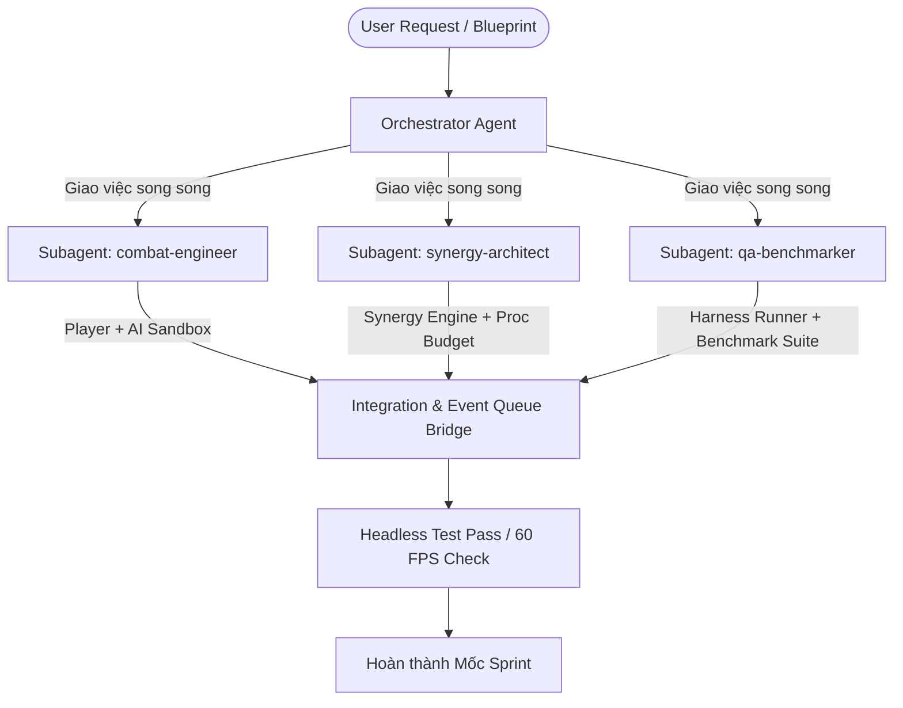

# Augment Survivors — Multi-Agent Architecture & Workflow

Tài liệu quy định phương pháp làm việc và phối hợp giữa các Multi Subagents cho dự án **Augment Survivors**, kế thừa mô hình từ `couple-chaos` và tối ưu hoá cho thể loại **Action Roguelite / Synergy Builder** trên Godot 4 (sử dụng Gemini Model).

---

## 1. Nguyên Tắc Hoạt Động (Principles)

- **Gemini Engine / Models**: Mọi subagent kế thừa model Gemini đang dùng hoặc chuyên biệt hoá theo task (`flash` cho quick unit test/asset slicing, model chính cho architecture/implementation).
- **Phân tách trách nhiệm (Separation of Concerns)**: Các subagent làm việc độc lập trên các module/thư mục riêng biệt, tránh xung đột cùng sửa 1 file:
  - `combat-engineer`: `scripts/combat/`, `scenes/combat/`, `scenes/entities/`
  - `synergy-architect`: `scripts/synergy/`, `data/augments/`, `scripts/rng/`
  - `qa-benchmarker`: `tests/`, `tools/benchmarks/`, `data/harness/`
- **Tài liệu tham chiếu bắt buộc**:
  - `DESIGN_BLUEPRINT.md`: Kế hoạch và 48 quyết định chốt.
  - `HARNESS.md`: Quy trình test harness headless và visual.
  - `VISUAL_CONTRACT.md`: Chuẩn UI layout, 6 màn hình game flow và mechanic telegraph từ ảnh concept gốc `references/game_ui_flow_reference.jpg`.
- **Agent chính (Antigravity Orchestrator)**: Điều phối luồng, giao task song song, tổng hợp kết quả, quản lý seed & merge.
- **Harness-driven Development**: Không bao giờ thêm feature hay mechanic mà không có harness test (headless runner hoặc visual scenario preset).

---

## 2. Danh Sách Subagents Chuyên Biệt

| Subagent | Role | Phạm vi trách nhiệm |
| :--- | :--- | :--- |
| **`combat-engineer`** | Combat Engineer | Player movement (8-way, dash), Weapon auto-target & projectile, Enemy AI (Swarm, Flanker, Boss), Telegraph system, Object pooling. |
| **`synergy-architect`** | Synergy Architect | 3 Elements (Fire/Burn, Ice/Chill, Lightning/Arc), Event Queue, Proc Budget, 8 Augment Resources (`.tres`), 3 RNG streams tách biệt. |
| **`qa-benchmarker`** | QA & Benchmarker | Headless CI runner, Visual Combat Harness, Stress-test 300+ quái 60 FPS, Deterministic seed verification, Telemetry & Session logging. |

---

## 3. Quy Trình Chạy Song Song (Parallel Execution Flow)

---

## 4. Lệnh Điều Hành Mẫu

Khi cần chạy task song song:
1. `combat-engineer`: Tạo prototype di chuyển và hai archetype địch.
2. `synergy-architect`: Khởi tạo cấu trúc Resource Augment và Event Queue.
3. `qa-benchmarker`: Viết test script headless runner xác nhận frame rate và loop an toàn.
