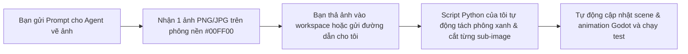

# Kế Hoạch Gom Batch & Hướng Dẫn Tách Asset Tự Động

Tài liệu hướng dẫn quy trình tạo asset theo batch qua Agent vẽ ảnh, sau đó chuyển giao cho subagent kỹ thuật xử lý tự động cắt, xóa nền xanh và tích hợp thẳng vào game engine Godot 4.

---

## 1. Danh Mục 5 Batch Prompts Đã Thiết Lập

Tất cả các prompt đã được lưu thành từng file markdown độc lập tại thư mục `prompts/assets/`:

| Batch | File Prompt | Số Sub-images | Nội Dung & Mục Tiêu |
| :---: | :--- | :---: | :--- |
| **01** | [`prompts/assets/batch_01_player.md`](file:///Users/thanhpv/Documents/Work/augment-survivors/prompts/assets/batch_01_player.md) | **8 frames** (4x2) | Hoạt họa nhân vật chính (Anime Flame Mage): Idle, Walk, Cast, Dash. |
| **02** | [`prompts/assets/batch_02_enemies.md`](file:///Users/thanhpv/Documents/Work/augment-survivors/prompts/assets/batch_02_enemies.md) | **8 frames** (4x2) | Skeleton Warrior cầm kiếm (4 frames) & Dơi tím bay lượn (4 frames). |
| **03** | [`prompts/assets/batch_03_boss_colossus.md`](file:///Users/thanhpv/Documents/Work/augment-survivors/prompts/assets/batch_03_boss_colossus.md) | **6 frames** (3x2) | Boss The Ember Colossus đập sàn/quét quạt & Trụ tinh thể pha lê Crystal Core. |
| **04** | [`prompts/assets/batch_04_draft_cards.md`](file:///Users/thanhpv/Documents/Work/augment-survivors/prompts/assets/batch_04_draft_cards.md) | **6 cards** (3x2) | Bộ 3 thẻ bài draft viền neon (Ember Shot, Frostbite, Arc Bolt) & Thẻ Synergy. |
| **05** | [`prompts/assets/batch_05_projectiles_ui.md`](file:///Users/thanhpv/Documents/Work/augment-survivors/prompts/assets/batch_05_projectiles_ui.md) | **8 items** (4x2) | Đạn lửa 3 tia, đạn băng, tia sét, vụ nổ hơi nước, nút Dash tròn, Avatar HUD. |

---

## 2. Quy Trình Phối Hợp Giữa Bạn & Tôi

### Bước 1: Gửi Prompt Cho Agent Vẽ Ảnh
Bạn mở file prompt tương ứng trong thư mục `prompts/assets/` (ví dụ `batch_01_player.md`), copy đoạn code text ở **Mục 4** và đưa cho Image Generator Agent.

### Bước 2: Bàn Giao Ảnh Đầu Ra Cho Tôi
Khi nhận được ảnh (chỉ cần 1 ảnh duy nhất chứa lưới sub-images trên nền xanh `#00FF00`), bạn lưu ảnh vào thư mục dự án (hoặc upload qua chat) với tên gợi ý:
- `assets/incoming/batch_01_player.png`
- `assets/incoming/batch_02_enemies.png`
- `assets/incoming/batch_03_boss.png`
- `assets/incoming/batch_04_cards.png`
- `assets/incoming/batch_05_projectiles_ui.png`

### Bước 3: Tôi Tự Động Xử Lý
Chỉ cần bạn nhắn *"Đã có ảnh batch X"*, tôi sẽ:
1. Chạy bộ lọc Chroma Key thông minh bóc tách màu nền xanh `#00FF00`, giữ nguyên độ sắc nét và alpha kênh viền.
2. Cắt chính xác từng ô sub-image theo tọa độ lưới (bounding box).
3. Đổi tên và nạp trực tiếp vào SpriteFrames và UI của Godot 4.
4. Chạy bộ test headless kiểm tra game chạy ổn định.
